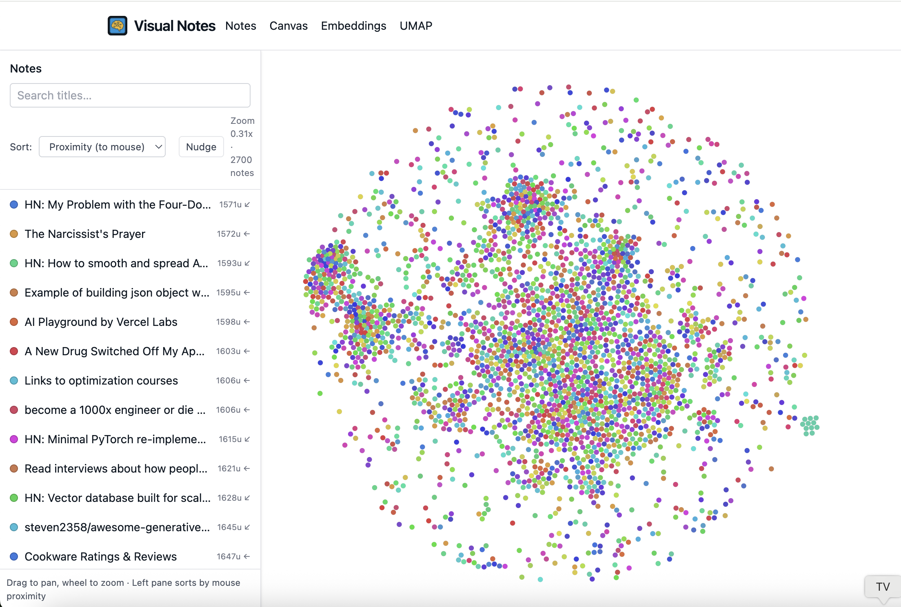

# Visual Notes

## Minimal Markdown Ingest Slice

This repo includes a minimal end-to-end slice to ingest a single Markdown document via API, persist it, and view it on the client. Images are intentionally omitted for now.



### What was added

- Minimal Prisma model `Doc` with `title`, `markdown`, `html`, timestamps
- API routes to ingest and fetch a document
- Home page with a simple ingest form that navigates to the document viewer
- Viewer page that renders the stored HTML
- Vitest integration test that mocks Prisma and exercises ingest + fetch

## Getting Started

### Prerequisites

- Node.js 24+ and pnpm 9.15.9 (pinned in `app/package.json`; run `corepack enable` or prefix commands with `corepack`)
- Postgres if you want to run against a real DB locally (Compose file available)

### Install deps and generate Prisma

```bash
cd app
pnpm install
pnpm prisma generate
```

### Create database schema (dev)

```bash
pnpm push
```

### Run the dev server

```bash
pnpm dev
```

The app runs at `http://localhost:3000`.

## API

Notes are created and edited in the app, by in-app AI, and by the ChatGPT MCP connector. Bulk ingest (the old `cli-ingest` tool and its sync endpoints) has been removed.

`POST /api/docs` creates one note for a signed-in client (the e2e fixtures use it):

```json
{ "title": "My Doc", "markdown": "# Hello\nSome text." }
```

It returns `{ "id": "..." }` with status 201.

## Live note updates

Open tabs refresh when notes change elsewhere (ChatGPT, other tabs, the CLI). See [app/docs/live-note-updates.md](app/docs/live-note-updates.md). A reverse proxy must forward WebSocket upgrades for `/ws/notes`.

## Collections

Collections are typed sets of notes, like Notion databases. Each row is an ordinary note, so search, links, revisions, and the ChatGPT connector all work on rows. The collection adds a property schema on top.

- **Pages:** `/collections` lists them, and `/collections/:id` shows saved views as tabs.
- **Views:**
  - *Table:* inline editing, filters, sorts, footer summaries, bulk edit, and windowed rows.
  - *Board:* grouped by a select or status property; drag cards to change the value.
  - *Gallery:* cards with a cover image and a body preview.
  - *Calendar:* a month grid by a date property; drag to reschedule.
- **Property kinds:** text (formats: plain, URL, email, phone), number (formats: plain, decimal, percent, currency, rating, progress), select, status (options grouped into To do, In progress, and Done), multi-select, date (with optional end date and time), checkbox, and created or updated time.
- **In notes:** type `/collection` to embed a live, editable view. A row's note page shows its properties and a link back to its collection.
- **Existing notes:** use "Add notes" on a collection page, or "Add to collection…" in a note's ⋯ menu. Meta keys that match property names fill those properties.
- **Storage:** values live on `Doc.properties`, keyed by property id; the row's body is the note's block content (`Doc.content`). Views and their filters live in `CollectionView`. The embed is the `collectionView` node in the shared note schema, and gallery covers and previews read bodies through the note store (`services/collections/note-summary.ts`). Plan and design notes are in [docs/intent/collections](docs/intent/collections/shape-brief.md).
- **Local fixtures:** run `cd app && node --experimental-strip-types --env-file=.env scripts/seed-collections.ts` against an audit database (`visual_notes_audit_*` only), then run `pnpm migrate:blocks --apply` to give the seeded rows block bodies.

## Testing

```bash
cd app
pnpm test
```

## Docker Quickstart

A minimal Compose setup lives in `app/docker-compose.yml` and runs Postgres + the app. No external APIs are required for the minimal Markdown ingest flow.

### One-liner

```bash
cd app && docker compose up --build
```

Then open `http://localhost:3000`.

## Codex MCP config

Codex reads repo-local MCP server settings from `/Users/byronwall/Projects/visual-notes/.codex/config.toml`.

This repo keeps Playwright on `--isolated` there so Codex sessions do not reuse a shared browser profile.

### What it does

- Starts Postgres (`db`) with default credentials and database `visual_notes`.
- Builds the app image, then runs it on port 3000.
- On container start, the app runs `prisma migrate deploy` automatically.
- `GET /api/version` (no sign-in) returns the deployed `commit` and server `startedAt`. The server reads `SOURCE_COMMIT` at runtime. Coolify sets it with its default "Runtime only" source-commit setting, which keeps the build cache. For docker compose by hand, run `SOURCE_COMMIT=$(git rev-parse HEAD) docker compose up -d`. Without it, the commit is `unknown`.
- Before serving requests, it fills missing `Doc.searchText` values in batches. This preserves note edit dates.
- Content writes keep plain search text current. PostgreSQL uses a `pg_trgm` index for substring matches.

### Environment (overrides)

In case you need to override ports or database settings:

```bash
# App port mapping (host:container)
APP_PORT=3000 \

# DB settings used by Compose and to construct DATABASE_URL
DB_USER=postgres \
DB_PASSWORD=postgres \
DB_NAME=visual_notes \
DB_PORT_EXPOSED=5432 \
docker compose up --build
```

Inside the app container, `DATABASE_URL` is set to `postgresql://postgres:postgres@db:5432/visual_notes?schema=public` by default.

## Embeddings + UMAP (New)

This app now supports computing OpenAI embeddings for each stored document and generating UMAP projections for visualization. The client canvas at `/visual` will automatically use the latest UMAP run to position notes (falls back to a seeded layout if no run exists).

### UI pages

- `/embeddings` — Create a new embedding run and view recent runs
- `/embeddings/[id]` — View a run, delete it, and trigger a UMAP run (2D/3D)
- `/umap` — Create a UMAP run for a selected embedding run and view recent runs
- `/umap/[id]` — View a UMAP run, delete it, and preview the first 48 points
- `/visual` — Canvas visualization; uses the latest UMAP run if present

### Environment

Set these in your shell or via Compose (see below):

- `OPENAI_API_KEY`: Required to call OpenAI embeddings API
- `EMBEDDING_MODEL`: Model id (default `text-embedding-3-small`)
- `UMAP_PYTHON_BIN`: Python executable for persisted UMAP (default `python3`)
- `UMAP_MODEL_DIR`: Directory for saved UMAP artifacts (default `/app/data/umap-models` in Docker)

The Compose file passes through `OPENAI_API_KEY`, sets a default for `EMBEDDING_MODEL`, and configures `UMAP_PYTHON_BIN`/`UMAP_MODEL_DIR`.

For local (non-Docker) runs, install Python deps once:

```bash
cd app
pnpm umap:setup:local
```

### Database models

- `EmbeddingRun(id, model, dims, params, createdAt)`
- `DocEmbedding(id, runId, docId, vector Float[], createdAt)`
- `UmapRun(id, embeddingRunId, dims, params, artifactPath?, createdAt)`
- `UmapPoint(id, runId, docId, x, y, z?)`

Embeddings are stored as `Float[]` for simplicity (no `pgvector` required). UMAP points are stored per-run so multiple runs can coexist. Persisted UMAP artifacts (`joblib`) allow reusing trained models for fast future `transform` calls.

### UMAP train vs project

- **Train (`createUmapRun`)**: fit Python `umap-learn`, persist artifact, write initial points.
- **Project (`projectUmapRun`)**: load artifact, transform fresh embeddings, upsert points without retraining.
- `processEmbeddingRun` now auto-projects newly embedded docs into trained UMAP runs for that embedding run, so fresh notes can appear immediately on the canvas.

### API endpoints

- `POST /api/embeddings/runs` → Computes embeddings for all docs and creates a new `EmbeddingRun`.
  - Body (optional): `{ "model": "text-embedding-3-small" }`
  - Response: `{ runId, count }`
- `GET /api/embeddings/runs` → Lists recent embedding runs
- `GET /api/embeddings/runs/[id]` → Returns a single run with `{ id, model, dims, params, createdAt, count }`
- `PATCH /api/embeddings/runs/[id]` → Update `model`, `dims`, or `params` metadata
- `DELETE /api/embeddings/runs/[id]` → Deletes the run and its `DocEmbedding` rows

- `POST /api/umap/runs` → Creates a UMAP projection for a given embedding run
  - Body: `{ "embeddingRunId": string, "dims": 2 | 3, "params"?: { "nNeighbors"?: number, "minDist"?: number, "metric"?: "cosine" | "euclidean" } }`
  - Response: `{ jobId: null, runId }`
- `GET /api/umap/runs` → Lists recent UMAP runs
- `GET /api/umap/runs/[id]` → Returns a single run with `{ id, dims, params, embeddingRunId, createdAt, count }`
- `PATCH /api/umap/runs/[id]` → Update `dims` or `params` metadata
- `DELETE /api/umap/runs/[id]` → Deletes the run and its `UmapPoint` rows
- `GET /api/umap/points?runId=...` → Returns `{ runId, dims, points: [{ docId, x, y, z? }], meta: { count } }`

### Quickstart: embeddings → UMAP → visualize

1. Ingest a few docs (see earlier examples), then compute embeddings:

```bash
curl -s -X POST http://localhost:3000/api/embeddings/runs \
  -H 'Content-Type: application/json' \
  -d '{"model":"text-embedding-3-small"}' | jq .
```

2. List embedding runs and pick one:

```bash
curl -s http://localhost:3000/api/embeddings/runs | jq .
```

3. Create a UMAP run from that embedding run:

```bash
EMB_RUN_ID="<paste-from-step-2>"
curl -s -X POST http://localhost:3000/api/umap/runs \
  -H 'Content-Type: application/json' \
  -d "{\"embeddingRunId\":\"$EMB_RUN_ID\",\"dims\":2,\"params\":{\"nNeighbors\":15,\"minDist\":0.1,\"metric\":\"cosine\"}}" | jq .
```

4. Open the canvas at `http://localhost:3000/visual`. The latest UMAP run is fetched automatically to position notes.

### Per-run examples (detail, update, delete)

Embedding run detail:

```bash
curl -s http://localhost:3000/api/embeddings/runs/<runId> | jq .
```

Update embedding run metadata:

```bash
curl -s -X PATCH http://localhost:3000/api/embeddings/runs/<runId> \
  -H 'Content-Type: application/json' \
  -d '{"params":{"note":"my tag"}}' | jq .
```

Delete embedding run (also removes vectors):

```bash
curl -s -X DELETE http://localhost:3000/api/embeddings/runs/<runId> | jq .
```

UMAP run detail:

```bash
curl -s http://localhost:3000/api/umap/runs/<runId> | jq .
```

Delete UMAP run (also removes points):

```bash
curl -s -X DELETE http://localhost:3000/api/umap/runs/<runId> | jq .
```

### Docker (embeddings + UMAP)

Pass your OpenAI key when starting Compose:

```bash
cd app
OPENAI_API_KEY=sk-... EMBEDDING_MODEL=text-embedding-3-small \
  docker compose up --build
```

The `app/docker-compose.yml` forwards `OPENAI_API_KEY` and sets a default `EMBEDDING_MODEL`. On container start, Prisma migrations are applied before serving.
