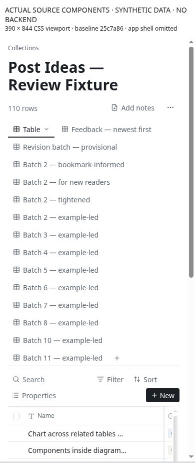
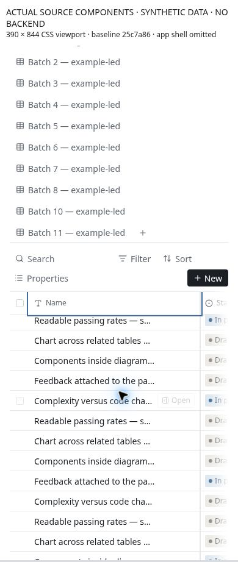
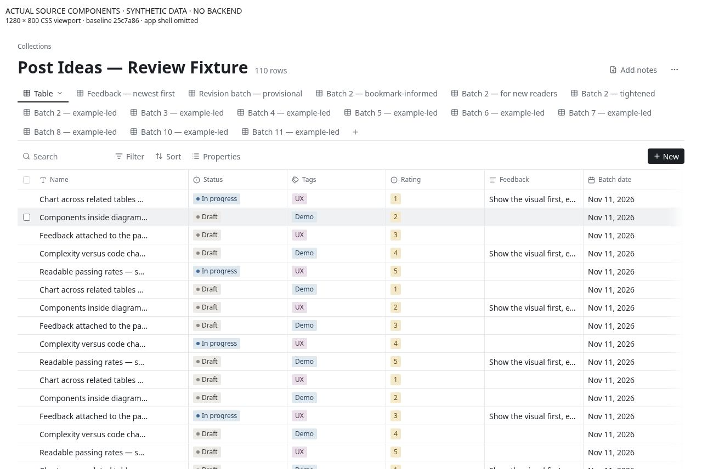
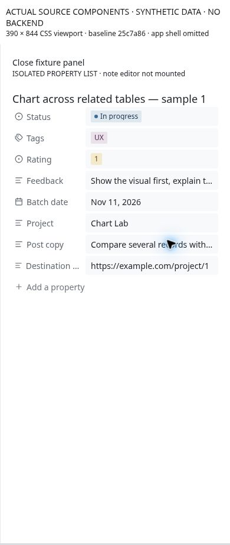
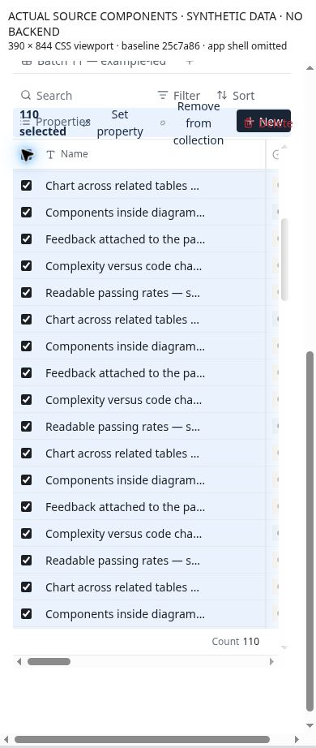

# Collections evidence register

## Baseline and provenance

- Source: `byronwall/visual-notes` at `25c7a864947994b8f321ceab73e6b8eae14e3107` (main at audit start).
- Browser: Chromium 156.0.8078.79 on Debian 13. These are CSS iframe viewports, not native mobile hardware or touch emulation.
- Date: 2026-11-11. This repository is public; all screenshot content is synthetic. There are no production note IDs, private note bodies, credentials or authenticated account screenshots in this change.
- Deployed browser: the app opened at sign-in. Authentication, deployed view settings and production behavior were **not** verified.
- Component runtime: actual current Collections components and store, generated Panda styles, synthetic 110-row/eight-property/15-view bundle. Server actions, membership and summary calls are stubs. Global app shell/sidebar omitted. Full RowPeekPanel replaced with a labelled actual PropertyList in actual SidePanel; no full note editor.
- Capture uses a viewport-sized iframe below a provenance banner. CSS dimensions below refer to the iframe, not the total JPEG. The banner adds screenshot height. Coordinates below are inside the iframe unless stated otherwise. Classic scrollbars in the runner consume space that overlay-scrollbar phones may not; measurements are not hardware-phone claims.
- Reproduction source is in [fixture/](fixture/README.md). The checked-in copy uses portable relative paths and loopback hosting rather than the capture runner's absolute paths/host binding. It was not recaptured after those portability-only edits.
- [Evidence manifest](evidence-manifest.json) records image paths, dimensions, byte counts and SHA-256 hashes. All committed screenshots were visually inspected.

## Measured geometry

| App CSS viewport | Views | View-tab height | Table y | Table client width | Table scroll width | Notes                                                   |
| ---------------- | ----- | --------------- | ------- | ------------------ | ------------------ | ------------------------------------------------------- |
| 320×800          | 15    | 522px           | 770px   | 258px              | 1,796px            | 312px frozen region exceeds client width; geometry only |
| 390×844          | 15    | 487px           | 735px   | 328px              | 1,796px            | 16px remains after 312px frozen region in this runner   |
| 430×932          | 15    | 452px           | 700px   | 368px              | 1,796px            | 56px remains; geometry only                             |
| 1280×800         | 15    | 102px           | 254px   | 1,186px            | 1,796px            | Laptop baseline and interaction captures                |
| 1366×768         | 15    | 102px           | 254px   | 1,272px            | 1,796px            | Supplemental laptop baseline                            |
| 1440×900         | 15    | 102px           | 254px   | 1,346px            | 1,796px            | Supplemental laptop baseline                            |

[Additional width measurements](additional-width-metrics.json) preserve the 320/430/1440 browser measurements. At 390px, overlay-scrollbar arithmetic is 390 − 32 route padding − 312 frozen identity = 46px; the measured 16px includes both outer and table classic scrollbar consumption. Neither figure is a claim that production has the same saved widths. The omitted app sidebar makes laptop available width more generous than many real configurations.

## Interaction observations

- **CU-05:** Focus row 0 column 8, press Tab repeatedly: focus remains row 0 column 8. Focus row 0 column 0, press Shift+Tab repeatedly: focus remains there. This used actual grid key handlers, not a recreation. The screenshot is illustrative; the key/focus sequence is the behavior proof.
- **CU-04:** Clicking the title enters the actual Edit name input. Open remains a separate hover/focus-disclosed control. No real mobile keyboard was tested.
- **CU-03:** Actual PropertyList displays plain Post copy and Feedback in 32px-high truncated fields. At 390px, editing the 203-character Post copy produces a 223×30px INPUT, not a textarea. Laptop detail also truncates. The property panel is an explicitly labelled fixture, not the full note editor.
- **CU-07:** Select all shows a bulk strip with Remove wrapping into three lines in a 28px button. It overlaps Properties/New. Clear selection begins at x=373.64px and is 29px wide, outside the 375px document client width. No delete or remove was executed.

## Screenshot gallery

All images are unaltered browser captures. Their synthetic-data banner and fixture labels are visible; no generated mockup is presented as the existing application.

### Phone default and table scrolled into view

[One-view control comparison](../../../pgm/data/projects/collections-usability/images/collections-audit/phone-390-one-view.jpg) shows that fewer tabs alone do not remove the frozen-width problem.

### Laptop comparison view

[1366×768 laptop](../../../pgm/data/projects/collections-usability/images/collections-audit/laptop-1366-default.jpg) · [1440×900 laptop](../../../pgm/data/projects/collections-usability/images/collections-audit/laptop-1440-default.jpg)

### Record opening and long-text properties

[Phone title click enters rename](../../../pgm/data/projects/collections-usability/images/collections-audit/phone-390-title-edit.jpg)

[Phone long-text input](../../../pgm/data/projects/collections-usability/images/collections-audit/phone-390-long-text-edit.jpg) · [Laptop PropertyList](../../../pgm/data/projects/collections-usability/images/collections-audit/laptop-1280-property-list.jpg) · [Laptop long-text input](../../../pgm/data/projects/collections-usability/images/collections-audit/laptop-1280-long-text-edit.jpg)

### Selection and keyboard

[Last-cell keyboard focus](../../../pgm/data/projects/collections-usability/images/collections-audit/laptop-1280-tab-trap.jpg) accompanies the repeated key/focus observation above.

## Coverage and limitations

| Area                              | Evidence obtained                                             | Still required                                                                 |
| --------------------------------- | ------------------------------------------------------------- | ------------------------------------------------------------------------------ |
| Default table and view navigation | Actual component screenshots/geometry, source inspection      | Full shell/sidebar, custom saved widths, production viewport and zoom          |
| Title/open and selection          | Actual component click/selection observations                 | Touch hardware and screen-reader exploration                                   |
| Long-text properties              | Actual PropertyList display/input screenshots on phone/laptop | Full note editor, persisted edits and network errors                           |
| Keyboard boundary                 | Actual grid repeated Tab/Shift+Tab focus observation          | Complete grid semantics and screen-reader conformance                          |
| Numeric stars/validation          | Source inspection                                             | Separate numeric fixture; current review fixture Rating is select              |
| Large-row reveal                  | Source risk                                                   | 300/2,000-row keyboard integration; 110 rows does not window                   |
| Board/gallery/calendar            | Source inspection only                                        | Real view screenshots, touch scroll/drag, keyboard and undated >100 test       |
| Save/concurrent writes            | Source risk                                                   | Controlled full-app failures, persistence after reload, no false-success proof |
| Create/import/schema              | Source inspection                                             | Full dialog flow, mapping/data guarantees and software keyboard                |
| Routes/Back/reload/embeds         | Source inspection and proposed contract                       | Authenticated end-to-end tests                                                 |
| Contrast, safe areas, OS keyboard | Not assessed                                                  | Dedicated measured/device accessibility checks                                 |

## Verification

- Lint: passed with 157 warnings on unchanged baseline source.
- Type-check: passed.
- Unit tests: 145 files passed, 15 skipped; 888 tests passed, 51 skipped.
- PGM report: 25 nodes, zero findings.
- Local Markdown/PGM image paths, image hashes, node parents, declared node types and issue routing: passed (`node docs/intent/collections-usability-audit-2026-11-11/validate-audit.mjs`).
- Application build/full E2E/database tests were not run locally. Draft PR CI is a separate result for its exact head SHA, not inferred from local checks.

## Capture scenarios

Default captures use `/viewport.html?w=390&h=844`, or the named laptop dimensions, with 110 rows and 15 unfiltered views. The one-view and title-edit phone captures use `views=1&rows=5`. Property detail screenshots use the labelled replacement panel and actual controls, not the full production peek. All laptop 1280 captures use 15 views/110 rows. The phone property-panel background row/view count was not independently preserved; use the compact five-row/one-view scenario for reproduction without treating it as captured provenance. The final 1440px geometry recheck reported 1,376px table client width when scrollbars were not consuming the earlier 30px; the initial captured measurement was 1,346px. Preserve scrollbar state when comparing exact geometry.
