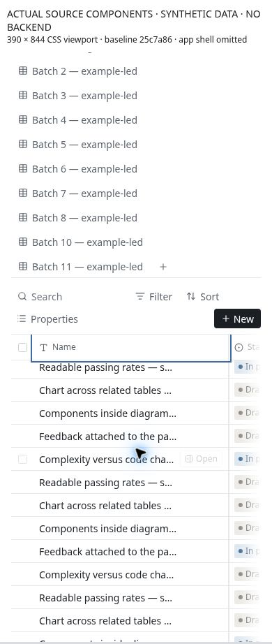
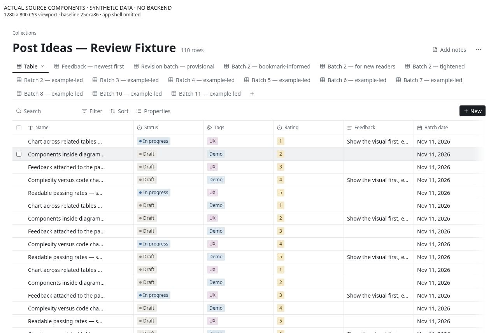
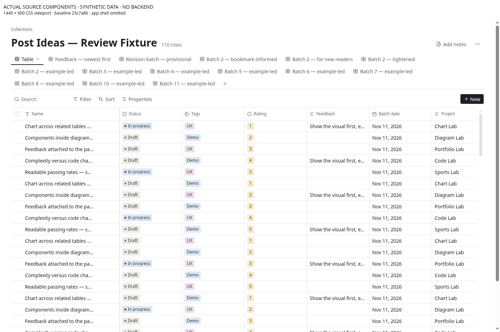

# CU-01 Make the narrow table usable without sacrificing row identity

**Priority:** P1 · **Evidence:** Component observed + source verified · **Baseline:** `25c7a864947994b8f321ceab73e6b8eae14e3107`

## Current behavior

The table freezes a 32px selection column plus a default 280px title column. Property columns default to 180px. The route adds 16px padding on both sides below md. Sticky headers, frozen identity, resize controls, and an edge fade already exist.

## User impact and gap

At a 390px viewport, a 358px content region leaves only 46px after the 312px frozen area. At 320px, the frozen area is wider than the 288px content region. Horizontal scrolling cannot make a 180px property fully legible while the frozen columns cover most of the visible region. Laptop tables still require prioritization rather than equal-width defaults.

## Reproduce

1. Load a synthetic 8-property collection with default widths at 320, 390 and 430px.
2. Scroll the table fully right and try reading/editing the last property without shrinking the title manually.
3. Repeat at 1280 and 1440px with a sidebar and a detail panel open.

## Likely ideal and proposed work

Introduce a compact record-list presentation for narrow screens with configurable 2–4 summary properties and a clearly named Table option. In narrow Table mode cap or release frozen title width, expose an obvious column-navigation affordance, and avoid global page overflow. Keep the laptop comparison table and existing sticky behavior.

## Acceptance and reassessment

- [ ] At 320/390/430px a user can identify a record and read/edit every property without an obscuring frozen region.
- [ ] At 1280/1440px headers and row identity remain visible during both-axis scrolling.
- [ ] Width and visibility choices remain view-specific; switching presentation does not create a duplicate dataset or drop fields.

Run R01 R02 in the [reassessment protocol](../../../../../docs/intent/collections-usability-audit-2026-11-11/reassessment.md). Record fixed commit, browser/device, before/after screenshots and test result. A source hypothesis becoming confirmed is a status/evidence update, not automatically a fix.

## Sources

- [app/src/components/collections/table/CollectionTable.tsx](https://github.com/byronwall/visual-notes/blob/25c7a864947994b8f321ceab73e6b8eae14e3107/app/src/components/collections/table/CollectionTable.tsx) · DEFAULT_WIDTH, TITLE_WIDTH, SELECT_COLUMN, stickyTitle.
- [app/src/routes/collections/[id].tsx](https://github.com/byronwall/visual-notes/blob/25c7a864947994b8f321ceab73e6b8eae14e3107/app/src/routes/collections/[id].tsx) · responsive Container padding.

See the [evidence register](../../../../../docs/intent/collections-usability-audit-2026-11-11/evidence.md) for coverage and screenshot provenance. The audit does not claim these observations were reproduced in the authenticated deployed app.

## Observed component evidence

At 390×844 the table has 328px internal client width and 1,796px scroll width. Its 312px frozen area leaves 16px exposed in this runner with classic scrollbars. At 1280×800 the client width is 1,186px; at 1440×900 it is 1,346px. These are synthetic default-width components with no app sidebar, not deployed saved settings.

