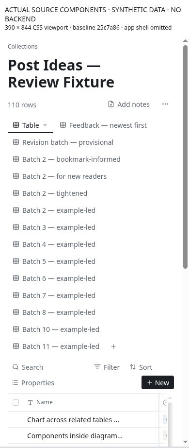
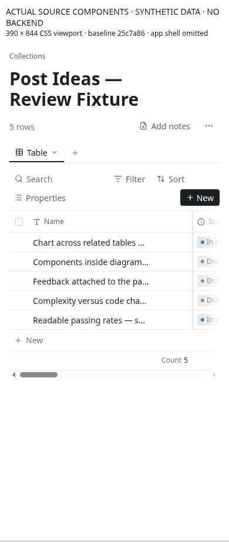
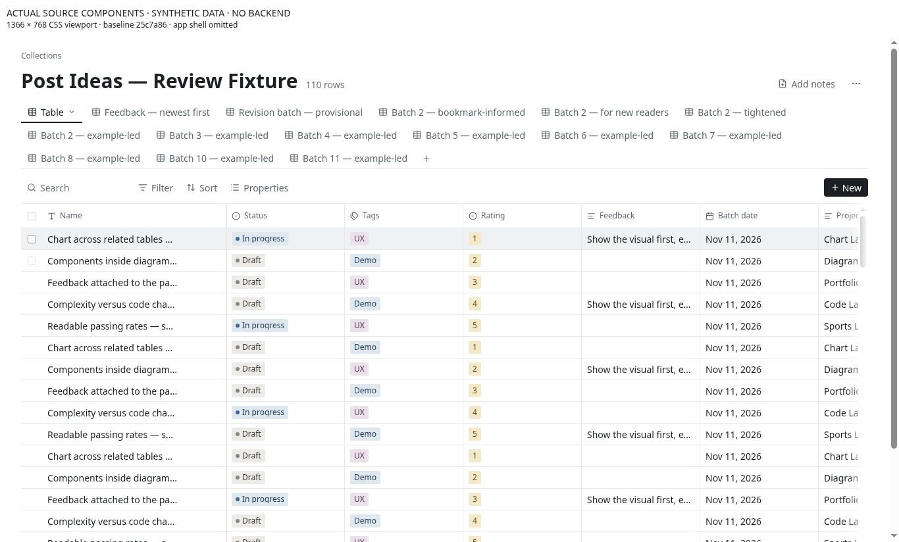

# CU-02 Bound saved-view navigation as the collection grows

**Priority:** P1 · **Evidence:** Component observed + source verified · **Baseline:** `25c7a864947994b8f321ceab73e6b8eae14e3107`

## Current behavior

ViewTabs renders every saved view in a flex-wrap bar. The active view also doubles as the settings-menu trigger. The table max-height subtracts a constant 12rem, independent of how many view or toolbar lines wrap.

## User impact and gap

A collection with 15 views can spend a large fraction of a phone viewport on navigation before any records appear. A fixed vertical subtraction cannot account for this growth. Laptop users also lose scan space as view count and names grow.

## Reproduce

1. Render 1, 5, 15 and 30 views with short and long names.
2. Select a view near the end at 390px; measure header/tab height and first visible record.
3. At 1280px and 200% zoom, open the active-view menu and switch views repeatedly.

## Likely ideal and proposed work

Use a compact active-view selector with searchable overflow on narrow screens; use a bounded strip with overflow on laptops. Separate switching from rename/layout/delete settings. Size the record region from actual available space instead of a guessed header budget.

## Acceptance and reassessment

- [ ] 15 views do not create an unbounded stack above the records.
- [ ] The active view is always identifiable and all views are reachable by touch and keyboard.
- [ ] Filter/search and record content remain visible at short viewport heights and 200% zoom.

Run R01 R03 in the [reassessment protocol](../../../../../docs/intent/collections-usability-audit-2026-11-11/reassessment.md). Record fixed commit, browser/device, before/after screenshots and test result. A source hypothesis becoming confirmed is a status/evidence update, not automatically a fix.

## Sources

- [app/src/components/collections/views/ViewTabs.tsx](https://github.com/byronwall/visual-notes/blob/25c7a864947994b8f321ceab73e6b8eae14e3107/app/src/components/collections/views/ViewTabs.tsx) · bar and active-tab SimplePopover.
- [app/src/components/collections/table/CollectionTable.tsx](https://github.com/byronwall/visual-notes/blob/25c7a864947994b8f321ceab73e6b8eae14e3107/app/src/components/collections/table/CollectionTable.tsx) · pageScroller maxH.

See the [evidence register](../../../../../docs/intent/collections-usability-audit-2026-11-11/evidence.md) for coverage and screenshot provenance. The audit does not claim these observations were reproduced in the authenticated deployed app.

## Observed component evidence

The 15-view bar measures 487px high at 390×844 and 102px at 1280×800/1440×900. Table y is 735px at 390 and 254px at 1440, measured inside the app iframe, excluding the outside provenance banner. Additional 320/430 measurements are in the evidence register.

