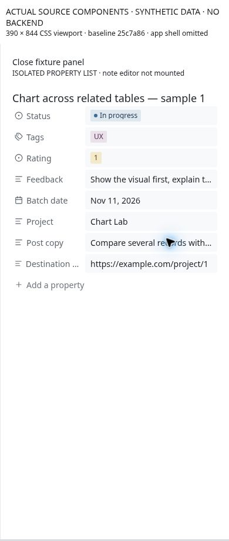
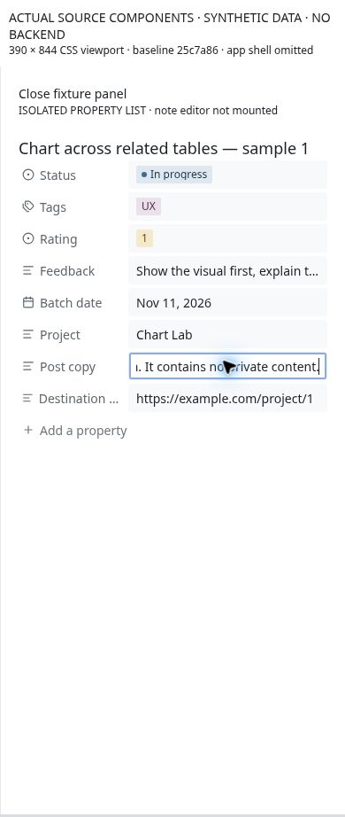
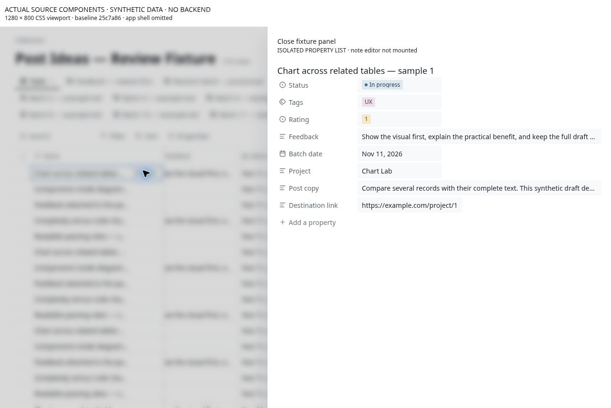
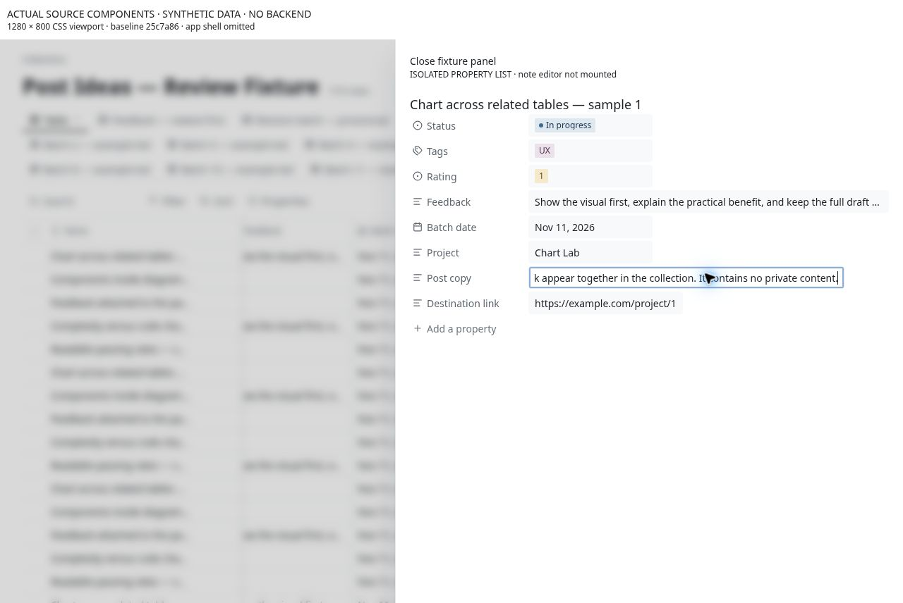

# CU-03 Read and edit full long-text properties in record detail

**Priority:** P1 · **Evidence:** Component observed + source verified · **Baseline:** `25c7a864947994b8f321ceab73e6b8eae14e3107`

## Current behavior

PropertyList passes wrap to ValueCell, but ValueDisplay applies wrap only to multi-select chips. Its plain-text fallback and URL text use nowrap/ellipsis. ValueCell uses a single-line input for text in both table and field variants.

## User impact and gap

Opening a note does not provide a readable long-text property surface. Draft copy, explanations and feedback remain truncated or become horizontally scrolling inputs. This affects laptop detail panels as well as phones and obstructs the core read → evaluate → comment journey.

## Reproduce

1. Create synthetic text and URL properties with 400+ characters and a paragraph break.
2. Open the row and inspect each property at 390px and in a 720px laptop panel.
3. Edit a middle sentence, add a line break, cancel, then commit.

## Likely ideal and proposed work

Render text field values with wrapping and preservation of intentional line breaks. Offer multiline editing for long text, with a bounded expandable read surface and explicit save/cancel affordances appropriate to touch. Keep compact table previews and distinct Open/Copy actions for links.

## Acceptance and reassessment

- [ ] Every character is readable in detail without sideways text scrolling.
- [ ] Multiline feedback can be entered and edited without Enter unexpectedly submitting.
- [ ] Cancel restores the previous value; commit, failure/retry and reopening are tested separately.

Run R04 R08 in the [reassessment protocol](../../../../../docs/intent/collections-usability-audit-2026-11-11/reassessment.md). Record fixed commit, browser/device, before/after screenshots and test result. A source hypothesis becoming confirmed is a status/evidence update, not automatically a fix.

## Sources

- [app/src/components/collections/PropertyList.tsx](https://github.com/byronwall/visual-notes/blob/25c7a864947994b8f321ceab73e6b8eae14e3107/app/src/components/collections/PropertyList.tsx) · ValueCell wrap.
- [app/src/components/collections/values/ValueDisplay.tsx](https://github.com/byronwall/visual-notes/blob/25c7a864947994b8f321ceab73e6b8eae14e3107/app/src/components/collections/values/ValueDisplay.tsx) · truncate fallback and chipsWrap.
- [app/src/components/collections/values/ValueCell.tsx](https://github.com/byronwall/visual-notes/blob/25c7a864947994b8f321ceab73e6b8eae14e3107/app/src/components/collections/values/ValueCell.tsx) · inlineInput and Enter handler.

See the [evidence register](../../../../../docs/intent/collections-usability-audit-2026-11-11/evidence.md) for coverage and screenshot provenance. The audit does not claim these observations were reproduced in the authenticated deployed app.

## Observed component evidence

Actual PropertyList inside the isolated panel truncates plain Post copy and Feedback at 32px field height. At 390px, clicking the 203-character Post copy opens an INPUT measuring 223×30px, not a multiline editor. Laptop property detail is also truncated. The full note editor was not mounted.

