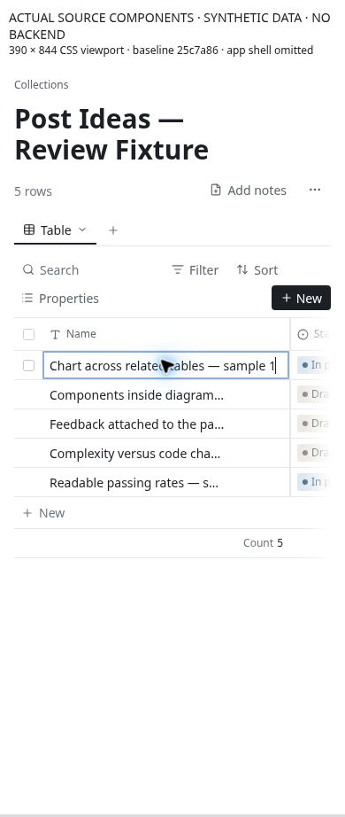

# CU-04 Make opening a record an obvious primary action

**Priority:** P1 · **Evidence:** Component observed + source verified · **Baseline:** `25c7a864947994b8f321ceab73e6b8eae14e3107`

## Current behavior

TitleCell makes the whole title area start rename editing. Open is an opacity-zero button until hover or focus-within. The Open button is 24px high; Shift+Space opens the row from a focused title, but that shortcut is not visible in the interface.

## User impact and gap

A user trying to inspect an existing note can unexpectedly enter rename mode. On a touch screen there is no hover discovery, and the obvious label does the less common task. Laptop users have to learn a hidden secondary target.

## Reproduce

1. Use a fresh touch-emulated visit without previous focus or hover.
2. Tap a title expecting to read the record, then dismiss the keyboard.
3. With a mouse, compare title hover, Open hover, title click and Open click.

## Likely ideal and proposed work

Make a visible record-opening target available at rest. In compact mobile lists let the title/record open detail; expose rename as a separate explicit action. Preserve a deliberate spreadsheet edit mode or keyboard shortcut for rapid laptop edits.

## Acceptance and reassessment

- [ ] A first-time touch user can open a record in one intentional action without entering rename.
- [ ] Nested links, rename, open and row selection have distinct visible targets and do not trigger one another.
- [ ] Keyboard users can discover and invoke both open and edit; focus returns to the originating row.

Run R02 R04 in the [reassessment protocol](../../../../../docs/intent/collections-usability-audit-2026-11-11/reassessment.md). Record fixed commit, browser/device, before/after screenshots and test result. A source hypothesis becoming confirmed is a status/evidence update, not automatically a fix.

## Sources

- [app/src/components/collections/table/TitleCell.tsx](https://github.com/byronwall/visual-notes/blob/25c7a864947994b8f321ceab73e6b8eae14e3107/app/src/components/collections/table/TitleCell.tsx) · root opacity selectors; onClick; Open button.

See the [evidence register](../../../../../docs/intent/collections-usability-audit-2026-11-11/evidence.md) for coverage and screenshot provenance. The audit does not claim these observations were reproduced in the authenticated deployed app.

## Observed component evidence

Clicking the synthetic row title opens the Edit name input rather than record detail. The separate Open control is available after hover/focus. This was a browser component interaction, not a real-phone software-keyboard test.

