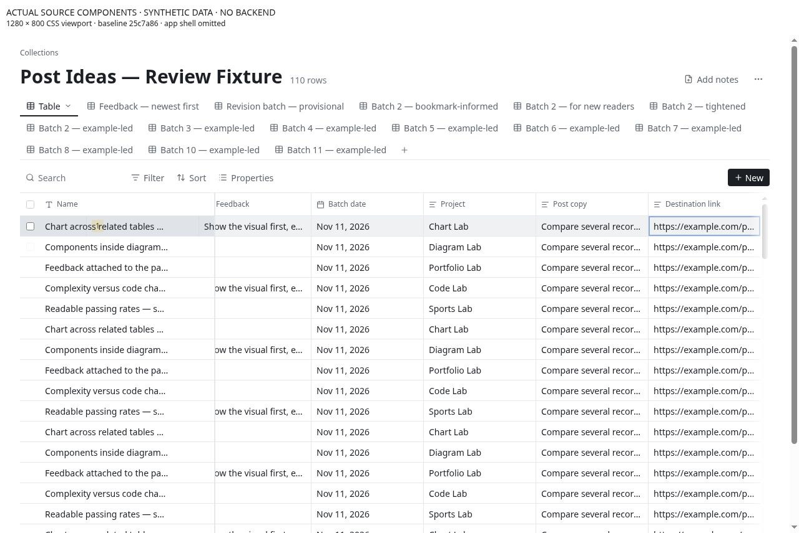

# CU-05 Let keyboard users enter and leave the grid predictably

**Priority:** P1 · **Evidence:** Component observed + source verified · **Baseline:** `25c7a864947994b8f321ceab73e6b8eae14e3107`

## Current behavior

CollectionTable intercepts Tab for [data-cell] and passes the next column to focusCell, which clamps at the first/last column. TitleCell and ValueCell each have tabIndex=0. The implementation does not implement a single managed grid entry point or explicit boundary exit.

## User impact and gap

Tab on the final property can return focus to the same cell; Shift+Tab on the first can do the same. Hundreds of separately tabbable cells also conflict with the expected composite-grid model. This is a laptop usability problem, not just an accessibility polish item.

## Reproduce

1. Focus the last property of the first row, press Tab three times and record activeElement.
2. Focus the first title cell and press Shift+Tab.
3. Traverse with Tab, arrow keys, Enter/F2, Escape and the inline editor Tab path.

## Likely ideal and proposed work

Choose and document one keyboard model. For a spreadsheet grid, implement roving focus, complete row/column semantics and an unambiguous Tab exit/entry policy; support edit-mode transitions. Do not simply suppress Tab and clamp it.

## Acceptance and reassessment

- [ ] Tab and Shift+Tab always provide an exit from the grid; no repeated keypress is trapped at a boundary.
- [ ] Arrow navigation and editor commits focus the expected cell without firing a different control.
- [ ] Screen-reader checks announce row, column, value and edit state; virtual rows have accurate indices.

Run R05 in the [reassessment protocol](../../../../../docs/intent/collections-usability-audit-2026-11-11/reassessment.md). Record fixed commit, browser/device, before/after screenshots and test result. A source hypothesis becoming confirmed is a status/evidence update, not automatically a fix.

## Sources

- [app/src/components/collections/table/CollectionTable.tsx](https://github.com/byronwall/visual-notes/blob/25c7a864947994b8f321ceab73e6b8eae14e3107/app/src/components/collections/table/CollectionTable.tsx) · focusCell and onGridKeyDown.
- [app/src/components/collections/table/TitleCell.tsx](https://github.com/byronwall/visual-notes/blob/25c7a864947994b8f321ceab73e6b8eae14e3107/app/src/components/collections/table/TitleCell.tsx) · tabIndex and editor key handlers.
- [app/src/components/collections/values/ValueCell.tsx](https://github.com/byronwall/visual-notes/blob/25c7a864947994b8f321ceab73e6b8eae14e3107/app/src/components/collections/values/ValueCell.tsx) · tabIndex and editor key handlers.

See the [evidence register](../../../../../docs/intent/collections-usability-audit-2026-11-11/evidence.md) for coverage and screenshot provenance. The audit does not claim these observations were reproduced in the authenticated deployed app.

## Observed component evidence

Repeated Tab on row 0 column 8 kept focus at row 0 column 8. Repeated Shift+Tab on row 0 column 0 kept focus there. The observed trap used the actual grid handlers; the screenshot alone is illustrative, while the key/focus sequence is the behavioral evidence.

