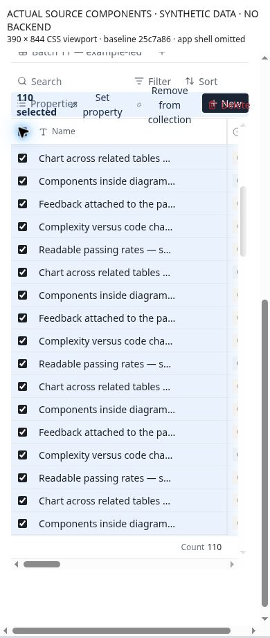

# CU-07 Keep selection and bulk actions reachable on narrow screens

**Priority:** P1 · **Evidence:** Component observed + source verified · **Baseline:** `25c7a864947994b8f321ceab73e6b8eae14e3107`

## Current behavior

Row checkboxes are opacity-zero until row hover or selection. BulkBar is a fixed-height absolute flex row with full text actions and no wrapping or overflow treatment. It overlays the toolbar above the table.

## User impact and gap

Touch users must discover invisible selection controls. Once selected, the long action strip can exceed the content width or compress important controls. Off-screen clear/delete actions make it harder to recover from selection mode.

## Reproduce

1. At 390px select one row and then several without using a mouse hover.
2. Open Set property and inspect Remove from collection, Delete and Clear selection.
3. Change filter/view while selected and inspect the selection count/scope.

## Likely ideal and proposed work

Provide an explicit touch selection mode or visible selection affordance. Use a compact selection bar with count, primary action, More, and always-visible Done/Clear. Keep Remove and Delete notes semantically distinct, preserving the existing confirmation descriptions.

## Acceptance and reassessment

- [ ] All actions and Clear are reachable at 320/390px without page overflow.
- [ ] Selection scope is explicit and accurate after filtering; hidden selected records cannot be affected unexpectedly.
- [ ] Delete notes vs remove membership are explained before commit; Cancel leaves all records untouched.

Run R07 in the [reassessment protocol](../../../../../docs/intent/collections-usability-audit-2026-11-11/reassessment.md). Record fixed commit, browser/device, before/after screenshots and test result. A source hypothesis becoming confirmed is a status/evidence update, not automatically a fix.

## Sources

- [app/src/components/collections/table/CollectionTable.tsx](https://github.com/byronwall/visual-notes/blob/25c7a864947994b8f321ceab73e6b8eae14e3107/app/src/components/collections/table/CollectionTable.tsx) · data-select-box opacity and selectedIds.
- [app/src/components/collections/table/BulkBar.tsx](https://github.com/byronwall/visual-notes/blob/25c7a864947994b8f321ceab73e6b8eae14e3107/app/src/components/collections/table/BulkBar.tsx) · bar and ConfirmDialog.

See the [evidence register](../../../../../docs/intent/collections-usability-audit-2026-11-11/evidence.md) for coverage and screenshot provenance. The audit does not claim these observations were reproduced in the authenticated deployed app.

## Observed component evidence

At 390px, Select all produces a fixed-height bulk strip whose Remove label wraps to three lines and overlaps Properties/New. Clear selection starts at x=373.64px with width 29px, beyond the 375px document client edge. No remove/delete action was executed.

